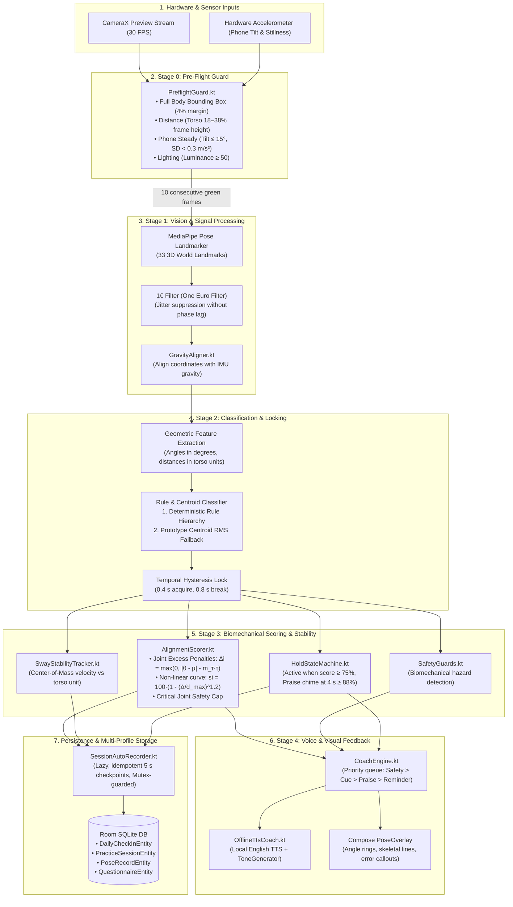

# Yoga Motor-Skill & Mental Wellness Companion

> **Edge-Native, Zero-Cloud, 100% Offline Android Application** for real-time biomechanical yoga pose tracking, physics-based scoring, offline voice coaching, longitudinal clinical wellness reflection, and interactive 3D procedural kinematics.

---

## 🌟 Overview & Core Principles

The **Yoga Motor-Skill & Mental Wellness Companion** is an edge-first health companion built with **Kotlin** and **Jetpack Compose**. It runs high-frequency computer vision pose estimation, biomechanical joint angle extraction, sway stability analysis, and conversational voice coaching directly on mobile hardware—**with zero network calls and the `android.permission.INTERNET` permission completely stripped**.

Alongside physical motor-skill practice, the app provides a longitudinal mental wellness tracking framework featuring standardized clinical self-reflection instruments (**PHQ-9** and **GAD-7**), daily holistic check-ins, non-parametric correlation analytics (tie-corrected Spearman's $\rho$ with Monte Carlo permutation tests), an immediate **Tele-MANAS** crisis intervention guardrail, an interactive **3D Asana Codex** with 32 procedural poses, and native 1-page clinical PDF reporting.

```
                                 THE THREE PILLARS
   ┌─────────────────────────┬─────────────────────────┬─────────────────────────┐
   │    1. MOTOR SKILL       │   2. MENTAL WELLNESS    │   3. PRIVACY & RIGOR    │
   ├─────────────────────────┼─────────────────────────┼─────────────────────────┤
   │ • 4 Scored Asanas       │ • Daily 1–10 Check-ins  │ • 100% Offline (No Net) │
   │ • Tadasana Calibration  │ • Fortnightly PHQ-9     │ • Edge ML (MediaPipe)   │
   │ • Real-time 1€ Filter   │ • Fortnightly GAD-7     │ • Spearman's ρ + Perm-p │
   │ • Biomechanical Scoring │ • Tele-MANAS 14416      │ • Honest No-Causation   │
   │ • Critical-Joint Caps   │ • Multi-Profile Demos   │ • Crashproof Recording  │
   │ • Offline Voice Coach   │ • 1-Page PDF Export     │ • Procedural 3D Codex   │
   └─────────────────────────┴─────────────────────────┴─────────────────────────┘
```

> **Medical & Wellness Disclaimer**: This application is an educational motor-skill and self-reflection companion. It is strictly not a medical or diagnostic device and does not diagnose, treat, or manage clinical conditions.

---

## 🛠️ Complete Technology Stack

| Layer | Technology | Details / Versions |
|---|---|---|
| **Language & Platform** | Kotlin / Android | Kotlin `2.0.21`, Java 17 / JVM 17 target, Android SDK Platform 35 (minSdk 26, targetSdk 35) |
| **UI Framework** | Jetpack Compose & M3 | Compose BOM `2024.10.01`, Material 3, Navigation Compose `2.8.4`, Custom Canvas 2D/3D renderers |
| **Computer Vision / ML** | Google MediaPipe | MediaPipe Tasks Vision `0.10.14`, `pose_landmarker_full.task` (float16, 33 3D world landmarks, memory-mapped) |
| **Camera Subsystem** | AndroidX CameraX | CameraX `1.3.4` (Camera2, Lifecycle, View, Preview with `FIT_CENTER`, `ImageAnalysis`) |
| **Sensor Fusion** | Android Hardware Sensors | Accelerometer via `SensorManager` (`AccelerometerMonitor` for pitch, roll, and device stillness) |
| **Signal Processing** | Pure Kotlin Math | Adaptive 1€ Filter (One Euro Filter for jitter reduction), Gravity Aligner (sensor-fused coordinate transformation) |
| **Local Persistence** | AndroidX Room & SQLite | Room `2.6.1` with KSP `2.0.21-1.0.28`, SQLite schema v1 $\to$ v2 in-place migration, foreign key cascade |
| **Concurrency & Async** | Kotlin Coroutines & Flow | Coroutines `1.8.1`, `StateFlow`, `SharedFlow`, background application scope, mutex-guarded checkpointing |
| **Audio & Speech** | Android Native Media | Android `TextToSpeech` (strictly filtered for local, offline English voice engines), `ToneGenerator` for auditory biofeedback |
| **Report Generation** | Android Native Graphics | Native `PdfDocument` vector & tabular layout, AndroidX `FileProvider` sandbox cache sharing |
| **Testing & Quality** | JVM & AndroidX Test | JUnit 4, Robolectric `4.14.1` (headless Compose rendering & screenshot capture), Coroutines Test, Lint (`abortOnError = true`) |

---

## 🏛️ System Architecture

The application is structured following Clean Architecture and MVVM patterns with Unidirectional Data Flow (UDF). The core live processing loop and persistence systems operate completely decoupled from the Android UI toolkit.

### End-to-End Architectural Pipeline



---

## 🔬 How It Works: In-Depth Technical Breakdown

### 1. Stage 0: Pre-Flight Guard (`PreflightGuard.kt`)
Before scoring starts, the app validates that the physical setup allows reliable measurement:
- **Full Body Visibility**: Evaluates key landmarks (nose, wrists, ankles) with visibility $\ge 0.60$ and requires them to stay within a $[0.04, 0.96]$ normalized screen margin.
- **Distance Check**: The user's torso length must occupy between $18\%$ and $38\%$ of the total frame height (empirically corresponding to $2.0\text{ m} - 3.0\text{ m}$ distance).
- **Phone Stillness & Tilt**: Accelerometer readings ensure device pitch and roll stay $\le 15^\circ$ from upright, with acceleration standard deviation $\text{SD} < 0.3\text{ m/s}^2$.
- **Ambient Lighting**: Average centre-crop luminance must be $\ge 50$.
- **Arming Mechanism**: Scoring arms only after **10 consecutive all-green frames** (~0.4s). If the phone is knocked or picked up (25 consecutive frames of tilt/motion), scoring immediately disarms.

### 2. Stage 1: Landmark Smoothing & Gravitational Normalization
- **MediaPipe Tasks Vision**: Generates 33 full-body 3D keypoints ($x, y, z$) with visibility and presence confidence.
- **1€ Filter (`OneEuroFilter.kt`)**: Jitter in joint keypoints is smoothed using an adaptive low-pass filter:
  - At low speeds, cut-off frequency drops to minimize jitter.
  - At high speeds, cut-off frequency increases to eliminate lag during dynamic movement.
- **Gravity Aligner (`GravityAligner.kt`)**: Normalizes landmark coordinates against the device accelerometer's downward gravity vector, preventing tilted cameras from skewing vertical trunk measurements.

### 3. Stage 2: Classification & Hysteresis Locking (`RuleAndCentroidClassifier.kt`)
- **Deterministic Geometric Decision Tree**: Scale-invariant geometric checks evaluated in strict hierarchy:
  1. **Vrikshasana (Tree)**: Lifted ankle near standing knee ($\Delta x < 0.35\text{ Torso}$), vertical separation $\Delta y > 0.22\text{ Torso}$, standing knee straight ($>155^\circ$). Detects left or right lifted leg.
  2. **Utkatasana (Chair)**: Feet down, narrow stance ($<0.85\text{ Torso}$), both knees deeply flexed ($75^\circ - 148^\circ$).
  3. **Virabhadrasana II (Warrior II)**: Wide stance ($>1.10\text{ Torso}$), upright trunk ($<25^\circ$), one knee flexed ($70^\circ - 142^\circ$), back knee straight ($>152^\circ$), arms abducted ($60^\circ - 120^\circ$). Detects leading leg.
  4. **Trikonasana (Triangle)**: Wide stance ($>1.00\text{ Torso}$), both knees straight ($>152^\circ$), lateral trunk tilt ($35^\circ - 95^\circ$). Identifies leading side from the lower wrist.
  5. **Tadasana (Mountain)**: Baseline neutral calibration pose. Both knees straight ($>162^\circ$), narrow stance ($<0.75\text{ Torso}$), arms down ($<35^\circ$), upright trunk ($<15^\circ$).
- **Prototype-Centroid Fallback**: If no deterministic rule fires, the engine computes normalized RMS distance against empirical asana centroids. A fallback match is only accepted if distance $\le 0.40$.
- **Temporal Hysteresis Lock (`TemporalLock.kt`)**: Requires 10 consecutive frames (~0.4s) of consistent classification to acquire a lock, and 20 consecutive non-matching frames (~0.8s) to release it, eliminating flickering during transitions.

### 4. Stage 3: Biomechanical Scoring Formula (`AlignmentScorer.kt`)
Joint angles are scored against clinical reference specifications (`AsanaSpecs.kt`) using a transparent, continuous, non-linear penalty curve:

1. **Excess Deviation ($\Delta_i$)**:
   $$\Delta_i = \max\left(0, |\theta_i - \mu_i| - m_\tau \cdot \tau_i\right)$$
   Where $\theta_i$ is measured smoothed angle, $\mu_i$ is target angle, $\tau_i$ is joint tolerance, and $m_\tau$ is the user tolerance profile multiplier (Beginner: $1.35$, Standard: $1.0$, Advanced: $0.75$).

2. **Joint Sub-Score ($s_i$)**:
   $$s_i = 100 \cdot \max\left(0, 1 - \left(\frac{\Delta_i}{d_{\max, i}}\right)^{1.2}\right)$$
   Where $d_{\max, i}$ is the maximum allowable deviation beyond tolerance. The $1.2$ exponent creates a forgiving plateau around the target followed by steep penalties for large misalignments.

3. **Weighted Raw Score ($S_{\text{weighted}}$)**:
   $$S_{\text{weighted}} = \frac{\sum_{i \in U} w_i \cdot s_i}{\sum_{i \in U} w_i}$$
   Computed over the set $U$ of visible joints ($>60\%$ of total pose weight must be visible, or score reports `null`).

4. **Critical-Joint Safety Cap ($S_{\text{align}}$)**:
   $$S_{\text{align}} = \min\left(S_{\text{weighted}}, \; 15 + 0.85 \cdot \min_{i \in U_{\text{crit}}} s_i\right)$$
   *Why this matters:* Compensatory posture (e.g., maintaining perfect arms while severely under-bending the front knee in Warrior II to $125^\circ$) is prevented from yielding a falsely high score. If a critical joint scores $31\%$, the entire pose score is strictly capped at $15 + 0.85 \times 31.1 = 41.4\%$.

### 5. Postural Sway, Stability, and Hold State Machine
- **Postural Sway (`SwayStabilityTracker.kt`)**: Tracks the 2D displacement velocity of the Center-of-Mass (mid-hip) normalized by torso length. Converts sway speed to a $0 - 100\%$ stability index.
- **Hold State Machine (`HoldStateMachine.kt`)**:
  - The hold timer advances **only** when $S_{\text{align}} \ge 75\%$.
  - Brief form drops ($< 1.0\text{ s}$) are cushioned by a grace period before resetting.
  - Holding $\ge 88\%$ for $4.0\text{ s}$ triggers a motivational audio chime and spoken praise.
  - Utkatasana includes a strict **30-second endurance cap** to protect the lumbar spine.

### 6. Biomechanical Safety Interventions (`SafetyGuards.kt`)
Safety rules preempt all scoring and alignment feedback. If a safety rule is violated, hold timers and praise are immediately paused:
- **Tree Pose Knee Guard**: Computes the relative vertical position $\lambda_{\text{tree}}$ of the lifted ankle along the standing leg. If $\lambda_{\text{tree}} \in [0.88, 1.12]$, the foot is pressing directly against the knee joint:
  > *"Move your lifted foot above or below your knee — never press on the knee joint."*
- **Warrior II Knee-Over-Ankle Guard**: Detects when the front knee overshoots the front ankle by $> 15\%$ of lower-leg length:
  > *"Your front knee is past your ankle. Ease up or widen your stance to protect the knee."*
- **Triangle Knee Hyperextension Guard**: Reconstructs depth-aware vertex position. If front knee angle exceeds $182^\circ$:
  > *"Soften your front knee — don't lock it backwards."*

### 7. Stage 4: Feedback Engine & Voice Coach (`CoachEngine.kt`, `OfflineTtsCoach.kt`)
- **Utterance Prioritization**:
  $$\text{Safety Interruption (Priority 0)} > \text{Pose Lock Announcement (Priority 1)} > \text{Corrective Cue (Priority 2)} > \text{Praise Chime (Priority 3)} > \text{Pain Reminder (Priority 4)}$$
- **Debouncing & Rate Limiting**:
  - Corrective cues are only spoken if the same joint remains the worst deficit for $> 1.2\text{ s}$.
  - $4.5\text{ s}$ minimum cooldown between spoken phrases.
  - The same cue will not repeat more than $2\times$ consecutively.
- **100% Offline Speech Synthesis**:
  - Uses native Android `TextToSpeech` filtered explicitly for voices with `!it.isNetworkConnectionRequired`.
  - Regional fallback preferring Indian English (`en-IN`), British English (`en-GB`), or US English (`en-US`).
  - Spoken cues appear simultaneously on screen as real-time captions for noisy or silent environments.

---

## 📊 Longitudinal Mental Wellness & Clinical Architecture

```
                    DAILY & FORTNIGHTLY WELLNESS PIPELINE
  ┌─────────────────────────┐          ┌───────────────────────────┐
  │   Daily Check-In        │          │ Clinical Questionnaires   │
  │ • Mood (1–10)           │          │ • PHQ-9 (Mood/Depression) │
  │ • Stress (1–10)         │          │ • GAD-7 (Anxiety/Worry)   │
  │ • Sleep Quality (1–10)  │          │ • Scheduled every 14 days │
  │ • Pre/Post Tension      │          │ • Non-diagnostic scoring  │
  └───────────┬─────────────┘          └─────────────┬─────────────┘
              │                                      │
              │                                      ▼
              │                           ┌──────────────────────────┐
              │                           │  Item 9 Crisis Check?    │
              │                           │  PHQ-9 #9 ≥ 1 ("Several")│
              │                           └──────────┬───────────────┘
              │                                      │ YES
              │                                      ▼
              │                          ┌───────────────────────────┐
              │                          │ Tele-MANAS 14416 / 112    │
              │                          │ Immediate Hotline Sheet   │
              │                          └───────────────────────────┘
              ▼
  ┌────────────────────────────────────────────────────────────────┐
  │ RankStatsEngine.kt: Honest Statistical Analytics               │
  │ • Tie-Corrected Spearman's ρ on Average Ranks                   │
  │ • Monte Carlo Permutation Test (5,000 Shuffles)                │
  │ • Strict Sample Threshold: n ≥ 14 Days                         │
  │ • Plain-English Caveats (Autocorrelation & Non-Causality)      │
  │ • Separate Stacked Trend Panels (Never Misleading Dual-Axis)   │
  └───────────────────────────────┬────────────────────────────────┘
                                  │
                                  ▼
  ┌────────────────────────────────────────────────────────────────┐
  │ PdfReportExporter.kt: 1-Page Clinical PDF Export               │
  │ Native Android PdfDocument • Vector Charts • FileProvider URI  │
  └────────────────────────────────────────────────────────────────┘
```

### 1. Daily Check-in & Self-Reflection
- Discrete, accessible $1 - 10$ rating sliders for **Mood**, **Stress**, and **Sleep Quality**.
- Optional single-tap pre-practice and post-practice muscular tension logs to observe immediate somatic relief.
- Unrated state by default: new accounts start at true zero without biased pre-filled values.

### 2. Clinical Instruments & Tele-MANAS Crisis Guardrail
- Standardized **PHQ-9** and **GAD-7** questionnaires administered on a 14-day schedule.
- Framed strictly as non-diagnostic *"Self-Reflection Check-In Scores"*; no diagnostic severity labels are ever assigned.
- **Immediate Crisis Guardrail (`CrisisSupportSheet.kt`)**: If the user scores $\ge 1$ (*"Several days"* or higher) on **PHQ-9 Item 9** (*thoughts of self-harm or being better off dead*), the app immediately opens a persistent crisis support sheet:
  - One-tap direct dialer to **Tele-MANAS** (India's National Tele Mental Health Programme: `14416` or `1-800-891-4416`).
  - One-tap dialer to **National Emergency** (`112`).
  - Supportive, non-judgmental messaging emphasizing 24/7 confidential professional help.

### 3. Honest Non-Parametric Statistics (`RankStatsEngine.kt`)
The app avoids pseudoscientific health claims by enforcing mathematical rigor:
- **Tie-Corrected Spearman's $\rho$**: Computes Pearson correlation on average-ranked rank vectors, making no assumptions of linearity or normal distribution.
- **Monte Carlo Permutation Testing**: Generates exact empirical two-sided p-values through $5{,}000$ random data shuffles:
  $$p = \frac{1 + \#\{|\rho_{\text{perm}}| \ge |\rho_{\text{obs}}|\}}{5000 + 1}$$
- **Strict Data Gates**: Correlations and significance claims are suppressed until at least **14 valid pairs ($n \ge 14$)** exist.
- **Explicit Caveats**: Every reported correlation explicitly warns the user:
  > *"Correlation reflects a pattern in your personal logs and does not prove causation—other factors like sleep and workload also vary."*
  > *"Daily self-reports are naturally autocorrelated across consecutive days, and a few weeks of logs is a small sample."*
- **Stacked Trend Visualization**: Trend graphs use two stacked independent panels (Alignment Quality $0 - 100$ above; Mood & Stress $1 - 10$ below) sharing a time axis. Dual-axis plots are strictly avoided to eliminate deceptive slope scaling.

---

## 🧘 Asana Codex & 3D Procedural Kinematics (`Learn` Tab)

The app includes an offline catalog of **32 classical yoga asanas** grouped into 6 practical categories:
1. **Desk** (Seated Twist, Wrist Stretches, Neck Releases)
2. **Morning** (Sun Salutation series, Cat-Cow, Downward Dog)
3. **Standing** (Warrior I, Warrior II, Triangle, Extended Side Angle)
4. **Balance** (Tree, Eagle, Half Moon, Dancer)
5. **Hips** (Pigeon, Butterfly, Lizard, Garland/Malasana)
6. **Evening** (Child's Pose, Reclining Twist, Legs-Up-The-Wall, Savasana)

```
                            3D SKELETAL RENDERING ENGINE
      [Pose Angles & Timing] ────────► [SkeletonRig.kt / FK Solver]
                                                   │
                                                   ▼
       Touch Orbit (360° Yaw) ───────► [3D ➔ 2D Perspective Projection]
       Two-Finger Pitch (0–60°)                   │
                                                   ▼
      [System Accessibility] ────────► [Compose SkeletonDemoCanvas]
       (Reduced Motion Support)         • Custom Canvas DrawScope
                                        • Dynamic Angle Callouts
                                        • Breathing Pacer Synced
```

- **Procedural Forward Kinematics (FK)**: Rather than bloating the APK with gigabytes of MP4 videos or GIF assets, poses are computed procedurally via a hierarchical skeletal rig (`SkeletonRig.kt`, `ForwardKinematics.kt`).
- **Interactive 360° Touch Orbit & 2-Finger Pitch Tilt**:
  - Horizontal drag spins the figure smoothly through $360^\circ$ yaw with realistic flick momentum.
  - Two-finger vertical drag tilts the perspective up to $60^\circ$ pitch (view from above with an elliptical floor disc).
  - Quick-action buttons for Front ($0^\circ$), $45^\circ$, Side ($90^\circ$), Back ($180^\circ$), and Turntable auto-rotate.
  - Double-tap instantly snaps the camera back to default.
- **Breathing Pacer**: Synchronized circular expansion/contraction guide promoting steady $4\text{ s}$ inhale, $4\text{ s}$ exhale cadence.
- **Accessibility & Reduced Motion**: Automatically queries Android's `TransitionAnimationScale`. If "Remove animations" is enabled, demos start paused at the peak pose.

---

## 💾 Resilient Session Auto-Recording (`SessionAutoRecorder.kt`)

Live yoga practice is recorded continuously to eliminate data loss:
- **Lazy Commitment**: Sessions with no held poses are never stored. A session begins recording only after any scored pose has been locked for $\ge 2.0\text{ s}$.
- **Idempotent 5-Second Checkpointing**: Active sessions are snapshotted and upserted to SQLite every $5\text{ s}$, and checkpointed instantly when the app is paused, screen locked, or camera toggled.
- **Crash & Process Termination Resilience**: Even if the Android OS suddenly kills the process, at most the last 4 seconds of practice are lost.
- **Concurrency Safety**: Synchronized using a Kotlin `Mutex` and monotonic sequence numbers, ensuring out-of-order coroutine writes can never overwrite newer session states.

---

## 👥 Multi-Profile Isolation System

To facilitate clean live demonstrations and research without polluting the user's authentic data:
- **👤 My Account**: The real user profile. Starts at true zero (no dummy data, unrated check-ins, empty stats).
- **Synthetic Personas**:
  - **Demo A · Consistent**: 42 days of regular yoga with high quality and steady mood improvement.
  - **Demo B · Exam Gap**: 42 days with a visible 10-day exam hiatus showing increased stress and post-gap recovery.
  - **Demo C · Null Pattern**: 42 days of random, uncoordinated logs illustrating honest non-significant statistical reporting ($p > 0.05$).
- **Strict Data Partitioning**: All database queries partition by `profileId`. Demo chips only appear after demo data has been explicitly activated from Settings. An amber banner clearly indicates when a demo is viewed, and exported PDFs are stamped `DEMO DATA`.

---

## 📁 Repository Structure

```
com.companion.yogawellness/
├── MainActivity.kt                 # Single Activity entry point
├── YogaWellnessApp.kt              # App lifecycle, singletons, DI container
│
├── camera/                         # Vision hardware integration
│   ├── AccelerometerMonitor.kt     # Phone orientation & stillness detection
│   └── PoseLandmarkerHelper.kt     # MediaPipe Tasks Vision wrapper
│
├── classifier/                     # Stage 2 pose recognition
│   ├── RuleAndCentroidClassifier.kt# Decision tree & prototype centroids
│   └── TemporalLock.kt             # Hysteresis state machine (0.4s/0.8s)
│
├── codex/                          # Learn library & 3D kinematics
│   ├── AsanaCatalog32.kt           # Master index of 32 asanas across 6 categories
│   ├── Catalog[Category].kt        # Desk, Morning, Standing, Balance, Hips, Evening
│   ├── ForwardKinematics.kt        # Kinematic solver from joint angles to 3D coords
│   ├── PoseTimeline.kt             # Parametric interpolation curves (entrance/hold/exit)
│   └── SkeletonRig.kt              # Bone hierarchy & joint connection topology
│
├── data/                           # Data access & persistence
│   ├── ActiveProfile.kt            # Profile state holder & preferences
│   ├── LiveSessionStore.kt         # Fast atomic session upsert contract
│   ├── SessionAutoRecorder.kt      # Crash-resilient 5s continuous recorder
│   ├── WellnessRepository.kt       # Facade for Room database operations
│   └── db/
│       ├── Daos.kt                 # Room DAOs (Sessions, Poses, Check-ins, Questionnaires)
│       ├── Entities.kt             # SQLite table schemas
│       └── WellnessDatabase.kt     # RoomDatabase definition & v1->v2 migration
│
├── feedback/                       # Coaching & safety systems
│   ├── CoachEngine.kt              # Rate-limited feedback decision state machine
│   ├── OfflineTtsCoach.kt          # Android TTS offline voice adapter & chimes
│   └── SafetyGuards.kt             # Biomechanical safety hazard detectors
│
├── pose/                           # Signal processing & geometry
│   ├── GravityAligner.kt           # Accelerometer sensor fusion & vertical tilt correction
│   ├── JointAngleExtractor.kt      # 3D vector math & angle calculation
│   ├── OneEuroFilter.kt            # Adaptive jitter filter
│   ├── PosePipeline.kt             # Orchestrates Stages 0 through 4 per frame
│   └── PreflightGuard.kt           # Bounding box, lighting, distance checks
│
├── replay/                         # Recording & synthetic clip evaluation
│   ├── DemoClips.kt                # Hardcoded synthetic correction sequences
│   ├── LandmarkRecorder.kt         # 20s .jsonl landmark stream capture
│   └── LandmarkReplayer.kt         # Replays .jsonl clips into the live pipeline
│
├── report/                         # Clinical reporting
│   └── PdfReportExporter.kt        # Native Android PdfDocument 1-page generator
│
├── scoring/                        # Biomechanical evaluation
│   ├── AlignmentScorer.kt          # Mathematical scoring engine with critical cap
│   ├── AsanaSpecs.kt               # Target angles, tolerances, weights & cues
│   ├── HoldStateMachine.kt        # Hold duration, grace window, praise trigger
│   └── SwayStabilityTracker.kt     # Center-of-mass velocity tracking
│
├── stats/                          # Scientific analytics
│   └── RankStatsEngine.kt          # Tie-corrected Spearman's ρ & Monte Carlo permutation
│
├── ui/                             # Jetpack Compose UI
│   ├── AppNavHost.kt               # Navigation router (Home, Learn, History, Insights)
│   ├── codex/                      # Asana Codex & 360° Skeleton Canvas
│   ├── components/                 # Design system (Cards, Buttons, Gauges, Artwork)
│   ├── dashboard/                  # Insights dashboard & stacked trend charts
│   ├── history/                    # Session list & manual logging dialog
│   ├── home/                       # Daily glance, streaks, activity summary
│   ├── practice/                   # Camera preview, real-time overlay, score explanation
│   ├── profile/                    # Profile switcher chips & amber demo banner
│   ├── settings/                   # Data erasure, demo loader, audio toggles
│   ├── theme/                      # Clinical Navy palette & typography tokens
│   └── wellness/                   # Check-in sliders, questionnaires, crisis sheet
│
└── wellness/                       # Aggregation & Mock Data
    ├── ActivitySummary.kt          # Streak tracking & weekly metric rollup
    ├── DashboardBuilder.kt         # Assembles data for the Insights tab
    ├── MockPersonaSeeder.kt        # Generates 42-day synthetic datasets (Demo A, B, C)
    └── Questionnaires.kt           # PHQ-9 & GAD-7 scoring & Tele-MANAS hotline metadata
```

---

## 🚀 Building & Running

### Requirements
- **JDK**: Java 17 or 21 (Android Studio bundled JBR works out of the box).
- **Android SDK**: Platform 35, Build-Tools 34 or 35.
- **Hardware**: Android device running Android 8.0+ (API 26+) with a camera.
  > **Note on Emulators**: Google MediaPipe `0.10.14` only ships native binaries for `arm64-v8a` and `armeabi-v7a`. Standard x86_64 desktop emulators will fail to load the C++ vision library. **Use a physical phone or an ARM64 system image.**

### 1. Build Debug APK
The 9 MB MediaPipe model (`pose_landmarker_full.task`) is automatically downloaded into `app/src/main/assets/` during the first build via the `downloadPoseModel` Gradle task.

```bash
# Linux / macOS
./gradlew :app:assembleDebug

# Windows PowerShell
.\gradlew.bat :app:assembleDebug
```
Output APK is located at: `app/build/outputs/apk/debug/app-debug.apk`.

### 2. Run JVM Unit & Robolectric Tests
Executes 43 comprehensive unit tests across scoring, classifier, kinematics, stats, Room migration, and headless Compose screens:

```bash
.\gradlew.bat :app:testDebugUnitTest
```

### 3. Lint Verification
Validates code style, accessibility semantics, and Android conventions:

```bash
.\gradlew.bat :app:lintDebug
```

### 4. Deploy to Physical Device
Connect your phone via USB with **USB Debugging** enabled:

```bash
.\gradlew.bat :app:installDebug
```

<<<<<<< HEAD
### 5. On-Device Instrumentation Tests
Validates real hardware camera initialization, MediaPipe model loading, and native `PdfDocument` rendering:
=======
On Windows use `gradlew.bat` instead of `./gradlew`. If Gradle cannot find the SDK, create `local.properties`
in the repo root containing `sdk.dir=/path/to/Android/Sdk`.

## What's in the app (v1.1)

The bottom bar has four tabs: **Home**, **Learn**, **History** and **Insights**. Practice, check-ins, questionnaires
and Settings open full-screen without the bar.

- **Live scoring covers exactly 4 poses:** Vrikshasana (Tree), Virabhadrasana II (Warrior II), Trikonasana
  (Triangle) and Utkatasana (Chair). Tadasana (Mountain) is the calibration pose and is never scored. The camera
  does not recognise any other pose.
- **Learn** lists 32 poses in six everyday categories with search and filters (All, Live-scored, Desk, Morning,
  Standing, Balance, Hips, Evening). Each pose opens an animated stick-figure demo (no video, no images: it is drawn
  procedurally from joint angles) with Front / 45° / Side views, 0.5× / 1× speed, pause at the peak, angle callouts,
  a breathing pacer, steps, common mistakes, easier options and a safety note. The 4 live poses have a
  **Practice this live** button. It opens Practice with a "Target" hint, but scoring is the same for every pose.
  The other 28 are follow-along demos only and are never scored or recorded. With *Remove animations* switched
  on in Android's accessibility settings, demos start paused at the peak pose.
- **Automatic session saving:** every scored pose you hold (locked) for **at least 2.0 seconds** is saved, whatever
  its score. The session is checkpointed every 5 s and again when you press Home, lock the screen, switch camera or
  start a replay, so a crash or a closed app loses at most a few seconds. A red **REC** badge shows the running
  session. **Finish & Save** shows a receipt, and **View History** opens the saved session. Replays are never
  recorded.
- **History** lists every session, newest first: duration, alignment and stability, per-pose hold times, the worst
  joint and the coaching cue. You can delete a session (with confirmation). Sessions logged by hand in older
  versions still show a **Manual** tag.
- **Demo profiles:** after loading demo data in **Settings → Demo data**, profile chips on Insights and History switch
  between **My Account** and three synthetic personas (Demo A · Consistent, Demo B · Exam Gap, Demo C · Null Pattern).
  A new account shows no chips and no demo data. A persona is generated the first
  time you view it and stored **beside** your data, never instead of it. While a demo is shown, an amber banner
  reads *"Viewing demo data (…). Your own data is safe."* with **Back to My Account**. Exported PDFs of a demo
  are labelled DEMO DATA. Anything you record (practice, check-ins, questionnaires) always goes to My Account.
  **Settings → Remove demo data** deletes only the personas. **Delete All My Data** still erases everything.
- **Upgrading from 1.0** keeps your data: the database migrates in place (Room v1 → v2) and never falls back to a
  destructive reset.

## Stage demo script

1. **First run** → accept the consent & safety screen (three boxes).
2. **Insights tab → profile chip "Demo A · Consistent"** shows 42 days of synthetic history (B = exam gap,
   C = null pattern). The amber banner confirms your own data is untouched. Tap **Back to My Account** before
   practising.
3. **Start practice** → prop the phone upright 2–3 m away. The pre-flight pills must all turn green
   (full body, distance, phone steady ≤15° tilt, lighting).
4. Stand in **Tadasana** for 5 s → "Calibrated".
5. **Warrior II with a shallow front knee (~125°)** → red 41% score ring, curved arrow on the knee, voice:
   *"Bend your front knee deeper toward 90 degrees"*. Tap **∑ Explain Score** to show every term of the formula.
6. Bend to ~95° → green, hold timer runs, chime + *"Beautiful. Hold it there."* after 4 s at ≥88%.
7. Do the other side → left-vs-right symmetry. Tap **Finish & Save** → receipt → **View History**: the session
   and both sides are listed with hold times, alignment and the worst joint. (It is saved even if you just press
   Home instead.)
8. **Insights tab** → switch to **Demo A** → weekly trend, symmetry, insight cards (ρ, p, n + caveats) →
   **Export PDF** (marked DEMO DATA) → share. Switch back to **My Account** to show your own session.
9. **Mood reflection (PHQ-9)** → answering item 9 with "Several days" opens the Tele-MANAS 14416 / 112 sheet.
10. **Learn tab** → *14. Warrior II* → the stick figure animates into the pose with angle callouts (front knee 95°,
    arms level). Switch Front / 45° / Side, then **Practice this live**.
11. Privacy proof: Android Studio → `app/src/main/AndroidManifest.xml` → **Merged Manifest** tab shows only
    `CAMERA` (plus AndroidX's app-private `DYNAMIC_RECEIVER_NOT_EXPORTED_PERMISSION`), no `INTERNET`.

**No camera / bad lighting on stage?** Practice screen → ⟲ (replay) → *Demo · Warrior II correction
(synthetic)* plays the same wrong → corrected sequence through the real pipeline, with voice.

## Tuning thresholds with real recordings

1. Practice screen → ⏺ records 20 s of landmarks (never images) to a `.jsonl` clip.
2. Copy clips to the test folder:
>>>>>>> 7ba278c7ed9d8e22a30181b25f764a38eb873e70

```bash
.\gradlew.bat :app:connectedDebugAndroidTest
```

### 6. Tuning Thresholds with Real Recordings & Offline Replay

You can record real user movement on-device and replay it deterministically on your workstation without needing a camera or physical subject:

1. On the **Practice screen**, tap **⏺ (Record)** to capture 20 seconds of smoothed landmarks (never images or video) to a `.jsonl` clip.
2. Pull the recorded clips to your local test suite:
   ```bash
   adb pull /sdcard/Android/data/com.companion.yogawellness/files/recordings/ app/src/test/resources/clips/
   ```
3. Replay clips through the exact live pipeline and print a detailed terminal report (temporal locks, joint scores, hold timers, spoken voice cues):
   ```bash
   .\gradlew.bat :app:testDebugUnitTest --tests '*RecordReplayTest.replayRecordedClips' -i
   ```

Joint targets and angular tolerances are configured in [`AsanaSpecs.kt`](app/src/main/java/com/companion/yogawellness/scoring/AsanaSpecs.kt); classifier heuristics in [`RuleAndCentroidClassifier.kt`](app/src/main/java/com/companion/yogawellness/classifier/RuleAndCentroidClassifier.kt); and sway mapping in [`SwayStabilityTracker.kt`](app/src/main/java/com/companion/yogawellness/scoring/SwayStabilityTracker.kt).

<<<<<<< HEAD
---
=======
| Blueprint | Code (`app/src/main/java/com/companion/yogawellness/`) |
|---|---|
| §2.1 manifest privacy | `app/src/main/AndroidManifest.xml`, `res/xml/data_extraction_rules.xml` |
| §5 pre-flight + IMU tilt | `pose/PreflightGuard.kt`, `pose/GravityAligner.kt`, `camera/AccelerometerMonitor.kt` |
| Stage 1 pose + angles + 1€ | `camera/PoseLandmarkerHelper.kt`, `pose/JointAngleExtractor.kt`, `pose/OneEuroFilter.kt` |
| §6 classifier + lock | `classifier/RuleAndCentroidClassifier.kt` |
| §7 scoring + specs | `scoring/AlignmentScorer.kt`, `scoring/AsanaSpecs.kt` |
| Sway, hold, symmetry | `scoring/SwayStabilityTracker.kt`, `scoring/HoldStateMachine.kt`, `scoring/SymmetryAndSession.kt` |
| Pipeline (stages 1–3) | `pose/PosePipeline.kt` |
| Stage 4 coach + safety | `feedback/CoachEngine.kt`, `feedback/SafetyGuards.kt`, `feedback/OfflineTtsCoach.kt` |
| Record / replay | `replay/LandmarkRecorder.kt`, `replay/LandmarkReplayer.kt`, `replay/DemoClips.kt` |
| §9 consent, check-in, PHQ/GAD, crisis | `ui/consent/`, `ui/wellness/`, `wellness/Questionnaires.kt` |
| §9.4 statistics | `stats/RankStatsEngine.kt` |
| Personas | `wellness/MockPersonaSeeder.kt` |
| Dashboard + PDF | `ui/dashboard/`, `wellness/DashboardBuilder.kt`, `report/PdfReportExporter.kt` |
| Room storage | `data/db/`, `data/WellnessRepository.kt` |
| Profiles + demo data (v1.1) | `data/ProfileIds.kt`, `data/ActiveProfile.kt`, `data/ProfileSwitcher.kt`, `ui/profile/` |
| Room 1→2 migration | `data/db/WellnessDatabase.kt` (`MIGRATION_1_2`), `app/schemas/` |
| Session auto-recording | `data/SessionAutoRecorder.kt`, `wellness/DailyAggregator.kt` (`SessionSummarizer`) |
| History | `ui/history/`, `wellness/HistoryAggregator.kt` |
| Learn / Asana Codex | `codex/` (rig, solver, timeline, 32-pose catalog), `ui/codex/` |
| Design system (colours, type, spacing, radii) | `ui/theme/Theme.kt`, `ui/theme/Type.kt` |
| Shared UI components + artwork | `ui/components/Kit.kt`, `ui/components/Artwork.kt` |
| Home summary (streak, week, sparklines) | `wellness/ActivitySummary.kt`, `ui/home/` |
>>>>>>> 7ba278c7ed9d8e22a30181b25f764a38eb873e70

## 💡 Key Engineering Decisions & Kinematic Design

<<<<<<< HEAD
- **`JointGeometry` Flexibility**: Replaces fixed landmark triplets with dynamic geometry models (`ThreePoint`, `BilateralAverage`, `SegmentVsVertical`, `SegmentVsHorizontal`) to support side-dependent anatomical variations and world-frame gravity alignment.
- **Knee Angles Above 180° (Hyperextension Awareness)**: A straight knee whose vertex passes behind the hip–ankle line in depth is computed as $360^\circ - \theta$. This allows the hyperextension safety guard ($> 182^\circ$) and "do not lock your knee" cues to trigger accurately.
- **Stacked Analytics Panels vs. Dual-Axis Plots**: The weekly trend dashboard displays two vertically stacked independent panels (Quality $0 - 100$ above; Mood & Stress $1 - 10$ below) sharing a time axis. Dual-axis plots are deliberately avoided because divergent y-scales can visually manufacture false correlations where none exist.
- **Preemptive Safety Priority**: Physical safety rules preempt alignment scores. If a safety rule is violated, hold timers and praise chimes are frozen immediately, regardless of whether remaining joints are green.
- **Synchronized Lock & Correction Speech**: When a pose lock announcement and an alignment correction coincide, they are spoken together in one fluid sentence so corrective cues are heard while the pose is still fresh.
- **Camera Preview FIT_CENTER**: The camera preview renders using `FIT_CENTER` (displaying the entire analysed sensor frame without cropping) so the user's perception of "full body in frame" matches the algorithmic bounding box.
- **Procedural Single-Segment Spine Solver**: Learn demos utilize a unified torso vector. Complex spinal curves (Cat-Cow, Cobra) are procedurally modeled through coordinated head, hip, and arm angles. `ForwardKinematicsTest` verifies every joint angle against the FK solver within $\pm 3^\circ$ ($\pm 5^\circ$ for compound twists).
=======
**Direction — "practice room".** A dark, warm-neutral interface. The app is used with the phone propped up
across a room, often in low light, and the camera screen is dark by nature, so every screen shares one dark
identity (the app is dark-only). The look comes from typography, spacing and restraint rather than decoration.

- **Colour** (`ui/theme/Theme.kt`, `AppTheme.colors`):
  - *Neutrals* are warm ink, not slate: `canvas` (page), `raised` (sheets, dialogs), `control` (inputs, selector
    tracks, media tiles), `line` / `lineStrong` (hairlines, outlines) and three text steps.
  - *Ivory* (`inverse`) is the action colour: primary buttons and the selected option of a selector.
  - *Jade* (`accent`) means "on target": active tab, progress, aligned joints, positive results.
  - *Amber* and *coral* are reserved for caution and problems; score bands use jade / amber / coral.
  - *Data series* (mood, stress, sleep, practice quality) have their own hues and appear only in charts and meters.
- **Type** (`ui/theme/Type.kt`, both SIL OFL and bundled — the app has no internet permission):
  - *Newsreader* (serif) for what you read as language: screen titles, the greeting, pose names, the findings
    on Insights. Sanskrit names use its italic (`SanskritStyle`).
  - *Inter* for everything you operate or measure: labels, controls, lists, and numbers — always with tabular
    figures (`NumericStyle`). Section headings are small, semibold and sentence case (`SectionStyle`).
- **Space and shape**: a 4-point scale with a 20 dp page gutter (`Space`); radii are 4 dp for small marks, 8 dp
  for anything you press or type into, 12 dp for media and sheets (`Radius`). Selectors use concentric radii.
- **Structure**: content is grouped into `Section`s separated by full-width hairlines and spacing — not cards.
  Raised fills are kept for controls, media tiles, sheets and dialogs. Lists run edge to edge (`ListRow`).
- **Screens** (`ui/components/Kit.kt`): `AppScreen` / `AppLazyScreen` give every screen the same slim bar; top-level
  screens open with a large serif title that hands over to the bar's small title on scroll.
- **Components**: `PrimaryButton` (ivory), `SecondaryButton` (outline), `TextAction`, `IconAction`, `Segmented`,
  `Chip`, `ScaleSelector` (1–10 rating), `SearchField`, `CheckRow`, `RadioRow`, `AppSwitch`, `Stat`, `Meter`,
  `SegmentMeter`, `Ring`, `Tag`, `StatusLabel`, `Notice` (a margin rule, not a box), `EmptyState`, `LoadingState`;
  artwork in `Artwork.kt` is the `PoseGlyph` line figure.
- **Navigation**: a hairline-topped bottom bar; the active tab has a filled icon, full-strength label and a short
  jade bar on the top edge — never colour alone, no pill.
- **Camera HUD**: translucent ink panels over the preview with the same ivory text, jade and score colours.
- **Screenshots**: `./gradlew :app:testDebugUnitTest --tests '*ScreenRenderTest*'` renders every screen (including
  full-length, narrow-phone, demo-data and 2× font variants) to `app/build/screenshots/`.
>>>>>>> 7ba278c7ed9d8e22a30181b25f764a38eb873e70

---

## 🎬 Stage Demo & Presentation Walkthrough

Follow this 11-step script for live demonstrations, judge presentations, or testing:

1. **Initial Launch**: Complete the three safety and consent checkboxes.
2. **Inspect Zero State**: The Home and Insights tabs start completely unpopulated; no fake or prefilled data exists.
3. **Load Demo Profile**:
   - Navigate to **Settings** $\to$ **Demo data** $\to$ **Load Demo Personas**.
   - Switch to **Demo A · Consistent** using the profile chip on the Insights tab.
   - Point out the amber banner (*"Viewing demo data... Your own data is safe"*).
   - Review 42 days of regular yoga, the stacked trend panels, and honest Spearman's $\rho$ correlation ($n \ge 14$).
   - Tap **Export PDF** to inspect the 1-page report marked `DEMO DATA`.
   - Switch back to **👤 My Account**.
4. **Setup Camera Practice**:
   - Tap **Start Practice**. Prop the phone upright against a wall $2 - 3\text{ m}$ away.
   - Show the pre-flight checklist: pills for **Full body**, **Distance**, **Phone steady** ($\le 15^\circ$ tilt), and **Lighting** turn green.
5. **Neutral Calibration**: Stand in **Tadasana** for 5 seconds until the calibration ring fills and announces *"Calibrated"*.
6. **Perform Warrior II with Deliberate Form Error**:
   - Take a wide stance, but keep the front knee shallow ($\sim 125^\circ$ instead of $95^\circ$).
   - Show the red $41\%$ score ring. Note the curved arrow pointing at the knee on the visual overlay.
   - Offline voice coach announces: *"Bend your front knee deeper toward 90 degrees."*
   - Tap **∑ Explain Score** to show the real-time breakdown of joint angles, tolerances, deficits, and the **Critical-Joint Cap** in action.
7. **Form Correction & Hold Praise**:
   - Deepen the knee bend to $\sim 95^\circ$.
   - The ring turns green ($>75\%$), and the hold timer starts counting.
   - After holding at $\ge 88\%$ for $4.0\text{ s}$, a cheerful chime plays and the coach announces: *"Beautiful. Hold it there."*
8. **Bilateral Symmetry & Auto-Recording**:
   - Switch sides to demonstrate left-vs-right symmetry computation.
   - Tap **Finish & Save** (or simply press Home / lock the screen: the continuous auto-recorder has already saved the session).
   - Navigate to the **History** tab to inspect the saved session, per-pose hold times, and worst joints.
9. **Mental Health Check-in**:
   - Open **Daily Check-In**; log mood, stress, and sleep.
   - Open **Questionnaires** $\to$ **Mood reflection (PHQ-9)**.
   - Answer Item 9 (*thoughts of self-harm*) with *"Several days"*.
   - Demonstrate the immediate, non-blocking **Tele-MANAS (14416 / 1-800-891-4416)** crisis support sheet.
10. **Explore 3D Asana Codex (`Learn` Tab)**:
    - Open **14. Warrior II** in the Learn catalog.
    - Drag horizontally to spin the skeleton figure $360^\circ$ with flick momentum.
    - Drag vertically with two fingers to tilt the view down by $60^\circ$ onto the circular floor grid.
    - Show angle callouts ($95^\circ$ front knee, $180^\circ$ back knee), breathing pacer, easier options, and the **Practice this live** shortcut.
11. **Privacy Verification**:
    - Open `app/src/main/AndroidManifest.xml` in Android Studio $\to$ **Merged Manifest** tab.
    - Verify that `INTERNET` and `ACCESS_NETWORK_STATE` are completely absent.

> **Stage Backup (No Camera/Poor Lighting)**: On the Practice screen, tap the replay button (**⟲**) and select *Demo · Warrior II correction (synthetic)* to run a pre-recorded sequence through the real pipeline with live scoring and audio.

---

## 🎨 Design System & UI Architecture

- **Visual Theme (`ui/theme/Theme.kt`)**:
  - Deep Clinical Navy (`#071A2F`) background with Teal and Mint (`#5EEAD4`) accents.
  - Semantic wellness tokens: Mood (Violet), Stress (Orange), Sleep (Indigo).
  - Clear biomechanical score bands: Green ($\ge 75\%$), Amber ($50\% - 74\%$), Red ($< 50\%$).
- **Typography (`ui/theme/Type.kt`)**:
  - Headings & Digits: **Plus Jakarta Sans** (bold, geometric clarity).
  - Body Text: **Inter** (clinical legibility).
  - Both fonts are bundled locally in `res/font/` (SIL Open Font License in `assets/licenses/`). No external font requests are made.
- **Custom UI Components (`ui/components/`)**:
  - `RingGauge`: High-precision animated circular score gauge.
  - `PanelCard`: Elevated clinical surface with subtle border strokes.
  - `MetricTile`: Clean metric readout with unit labels.
  - `PulseLine`: Custom-drawn animated ECG rhythm vector graphic.
  - `PoseGlyph`: Lightweight procedural joint glyph representing each asana.

---

## 🔒 Privacy & Safety Guarantees

1. **Zero Network Transmission**: The application strips `android.permission.INTERNET` at manifest merge time. It is physically impossible for the app to transmit data off the device.
2. **No Video or Image Storage**: The camera stream is analysed purely in volatile RAM buffers. No camera frames, photos, or video recordings are written to disk.
3. **Local Mathematical Storage**: Only raw joint coordinates (during explicit user recording) and aggregated numeric scalars (scores, angles, hold durations) are saved to the on-device SQLite database.
4. **Complete Data Sovereignty**: The user can export their complete history to a PDF document or permanently wipe all database tables at any time via **Settings $\to$ Delete All My Data**.

---

## 📄 License & Attributions

- **PHQ-9 & GAD-7**: Developed by Drs. Robert L. Spitzer, Janet B.W. Williams, Kurt Kroenke and colleagues with an educational grant from Pfizer Inc. Reproducible without permission for non-commercial and clinical educational use.
- **MediaPipe**: Distributed by Google LLC under the Apache License 2.0.
- **Fonts**: Plus Jakarta Sans and Inter are licensed under the SIL Open Font License 1.1.
